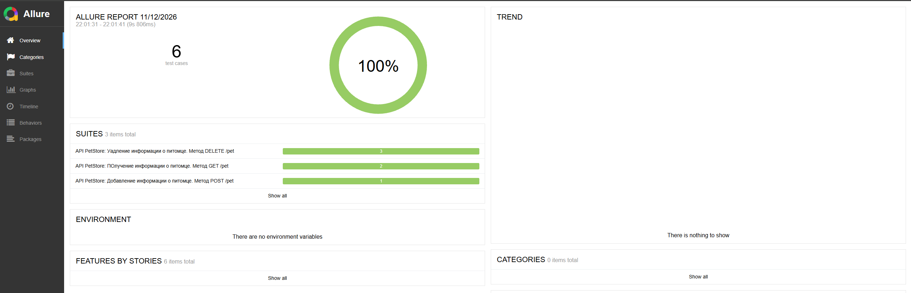
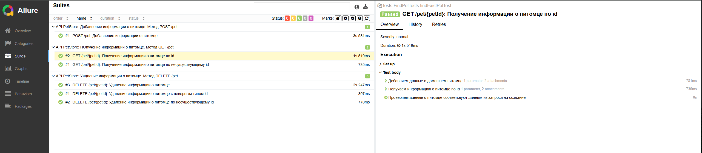
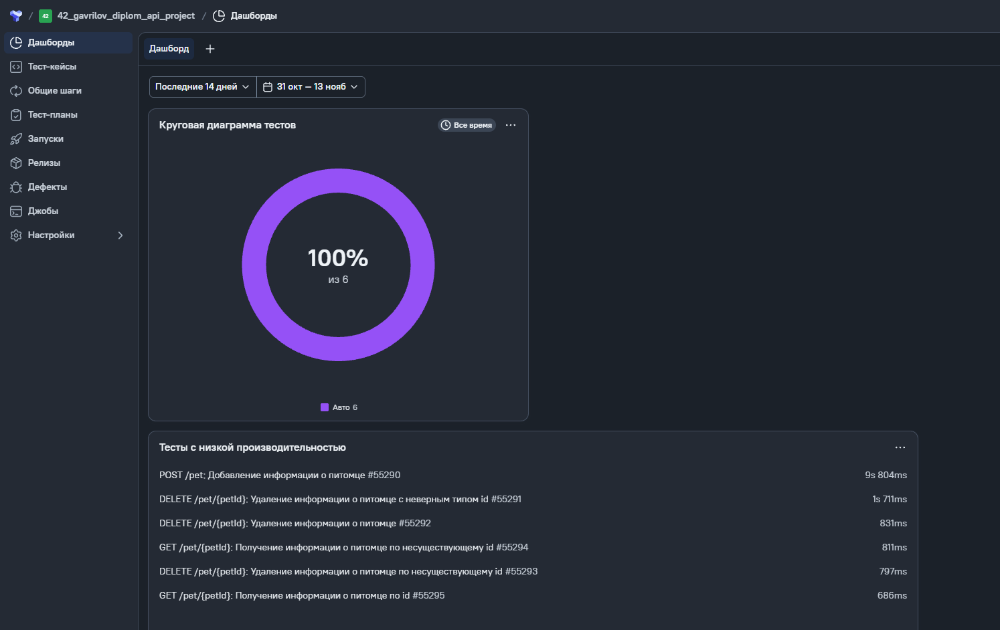
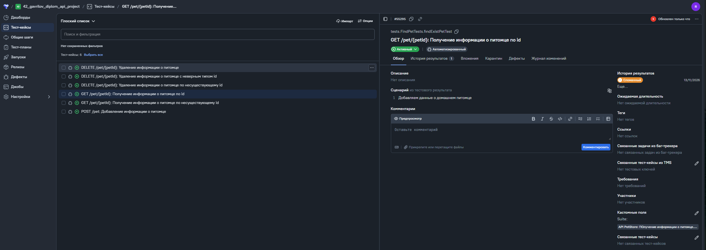
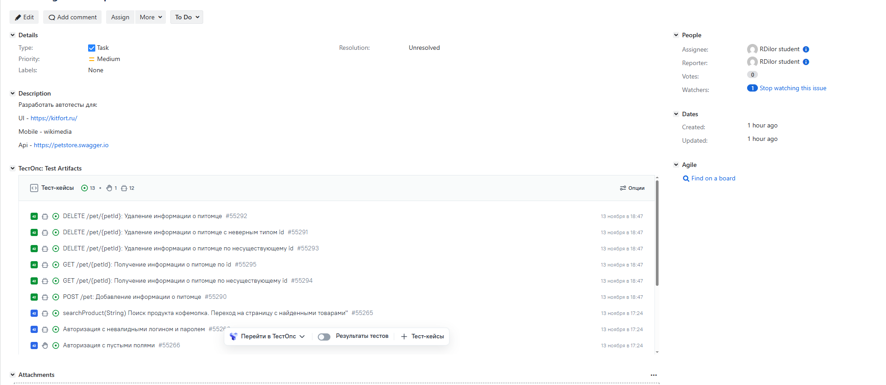

# API-тесты [PetStore](https://petstore.swagger.io)

Проект содержит автоматизированные API-тесты сервиса **Swagger Petstore**.

- [Технологический стек](#технологический-стек)
- [Объект тестирования](#объект-тестирования)
- [Покрытие тестами](#покрытие-тестами)
- [Структура проекта](#структура-проекта)
- [Назначение пакетов](#назначение-пакетов)
- [Запуск тестов](#запуск-тестов)
- [Описание Java-классов](#описание-java-классов)
- [Архитектура](#архитектура)
- [Allure-отчёт](#allure-отчёт)
- [Allure TestOps](#allure-TestOps)
- [Jira](#jira)
## Технологический стек

| Технология | Назначение |
|---|---|
| Java (records) | Язык тестов и модели данных |
| Gradle | Сборка и управление зависимостями |
| JUnit Jupiter 5.14.3 | Тестовый фреймворк |
| REST Assured 6.0.0 | HTTP-запросы и проверки ответов |
| JSON Schema Validator | Проверка структуры JSON |
| Allure 2.32.0 | Отчёты, шаги и HTTP-вложения |
| Allure REST Assured | Вложения запросов и ответов |
| Jackson Databind 3.1.0 | Сериализация и десериализация JSON |
| DataFaker 2.5.4 | Генерация тестовых данных |
| AssertJ 3.27.7 | Проверки в тестах |
| SLF4J 2.0.17 | Логирование |

## Объект тестирования

Публичный API Swagger Petstore:
- Базовый URL по умолчанию: `https://petstore.swagger.io`
- API base path: `/v2`
- Основной ресурс: `/pet`

Базовый URL можно переопределить системным свойством `baseUrl`.

## Покрытие тестами

В проекте реализовано **6 тестовых методов**.

| Тестовый класс | Endpoint | Сценарий |
|---|---|---|
| `CreatePetTest` | `POST /pet` | Создание питомца и проверка ответа |
| `FindPetTests` | `GET /pet/{petId}` | Получение существующего питомца |
| `FindPetTests` | `GET /pet/{petId}` | Получение питомца по несуществующему ID, проверка 404 |
| `DeletePetTest` | `DELETE /pet/{petId}` | Удаление существующего питомца и проверка, что он больше не найден |
| `DeletePetTest` | `DELETE /pet/{petId}` | Удаление питомца по несуществующему ID |
| `DeletePetTest` | `DELETE /pet/{petId}` | Удаление с некорректным типом ID |

## Структура проекта

```text
diplom_api_project/
├── build.gradle
└── src/test/
    ├── java/
    │   ├── allure/
    │   ├── api/
    │   ├── helpers/
    │   ├── models/
    │   │   ├── createpet/
    │   │   ├── deletepet/
    │   │   └── findpet/
    │   ├── specs/
    │   │   ├── createpet/
    │   │   ├── deletepet/
    │   │   └── findpet/
    │   ├── testdata/
    │   └── tests/
    └── resources/
        ├── schemas/
        ├── testdata/
        └── tpl/
```

### Назначение пакетов

- `api` — API-клиент и методы работы с ресурсом Pet.
- `specs` — общие спецификации запросов и спецификации ответов для операций.
- `models` — Java-модели тел запросов и ответов.
- `testdata` — тестовые данные и ожидаемые значения.
- `helpers` — генератор данных питомцев на основе CSV.
- `allure` — пользовательский REST Assured listener для Allure.
- `tests` — тестовые сценарии и базовый класс.

## Запуск тестов

Из корневой директории проекта:

```bash
gradle clean test
```

С альтернативным базовым URL:

```bash
gradle clean test -DbaseUrl=https://petstore.swagger.io
```

Запуск отдельного класса:

```bash
gradle test --tests tests.CreatePetTest
gradle test --tests tests.FindPetTests
gradle test --tests tests.DeletePetTest
```

Свойство `baseUrl` считывается в `tests.TestBase`; если оно не задано, используется `https://petstore.swagger.io`.

## Описание Java-классов

| Пакет | Класс | Назначение |
|---|---|---|
| `allure` | `CustomAllureListener` | Настраивает Allure REST Assured filter и шаблоны запросов/ответов |
| `api` | `ApiClient` | Предоставляет экземпляр `PetApiClient` |
| `api` | `PetApiClient` | Реализует создание, получение и удаление питомцев, включая негативные сценарии |
| `helpers` | `PetTestDataGenerator` | Читает категории и теги из CSV, выбирает категорию и генерирует ID |
| `models.createpet` | `PetBodyModel` | Record-модель тела питомца |
| `models.createpet` | `Category` | Record-модель категории |
| `models.createpet` | `Tag` | Record-модель тега |
| `models.deletepet` | `DeletePetResponseModel` | Record-модель ответа удаления |
| `models.findpet` | `NotFoundPetResponseModel` | Record-модель ошибки поиска |
| `specs` | `BaseSpec` | Общие настройки HTTP-запросов |
| `specs.createpet` | `CreatePetSpec` | Спецификация POST и успешного ответа создания |
| `specs.deletepet` | `DeletePetSpec` | Спецификации успешного и негативного удаления |
| `specs.findpet` | `FindPetSpec` | Спецификация негативного поиска |
| `testdata` | `BaseTestData` | Общие тестовые данные, Faker и ID несуществующего питомца |
| `testdata` | `CreatePetTestData` | Генерирует данные нового питомца |
| `testdata` | `DeletePetTestData` | Ожидаемые значения ответов и некорректный ID для DELETE |
| `testdata` | `FindPetTestData` | Ожидаемые значения ошибки при поиске отсутствующего питомца |
| `tests` | `TestBase` | Инициализирует базовый URI и общие объекты тестов |
| `tests` | `CreatePetTest` | Проверяет создание питомца |
| `tests` | `FindPetTests` | Проверяет получение существующего и несуществующего питомца |
| `tests` | `DeletePetTest` | Проверяет удаление существующего/несуществующего питомца и некорректный ID |


## Архитектура

### API-клиент

`ApiClient` — точка входа к API-клиентам, предоставляет поле `pet` типа `PetApiClient`.

`PetApiClient` инкапсулирует HTTP-вызовы:
- `create(PetBodyModel)` — `POST /pet`;
- `getPetById(Integer)` — `GET /pet/{id}`;
- `getNonExistPetById(Integer)` — негативный GET;
- `deletePetById(Integer)` — удаление существующего питомца;
- `deleteNonExistPetById(Integer)` — негативный DELETE;
- `deleteWithInvalidPetIdType(String)` — DELETE с некорректным ID.

### Спецификации

`BaseSpec` задаёт общие параметры запросов: JSON Content-Type, base path `/v2`, логирование и подключение кастомного Allure REST Assured filter.

Спецификации в пакетах `createpet`, `findpet` и `deletepet` задают ожидаемые HTTP-статусы и проверку JSON Schema там, где она предусмотрена.

### Модели данных

| Класс | Назначение |
|---|---|
| `PetBodyModel` | Модель питомца: ID, категория, имя, URL фотографий, теги и статус |
| `Category` | Категория питомца: ID и название |
| `Tag` | Тег питомца: ID и имя |
| `DeletePetResponseModel` | Ответ удаления: code, type, message |
| `NotFoundPetResponseModel` | Ответ об отсутствии питомца |


### Тестовые данные

`PetTestDataGenerator` загружает категории и теги из CSV, выбирает случайную категорию и генерирует ID.

`CreatePetTestData` формирует данные питомца:
- имя генерируется через DataFaker;
- категория выбирается из `categories.csv`;
- ID генерируется в диапазоне от 900 до 8999;
- теги загружаются из `tags.csv`;
- задаются URL фотографии и статус.

CSV-файлы:
- `src/test/resources/testdata/categories.csv` — категории `cat`, `dog`, `bird`;
- `src/test/resources/testdata/tags.csv` — теги `cute`, `playful`, `lazy`, `fluffy`.

Пути к CSV заданы относительно корня проекта, поэтому запускайте Gradle из корневой директории репозитория.

## [Allure-отчёт](https://jenkins.qa.guru/job/42_gavrilov_diplom_api_test/2/)

`CustomAllureListener` подключает `AllureRestAssured` и использует шаблоны:
- `src/test/resources/tpl/request.ftl` — отображение HTTP-запроса;
- `src/test/resources/tpl/response.ftl` — отображение HTTP-ответа.

Filter подключается в `BaseSpec`, поэтому запросы и ответы попадают во вложения Allure.

Создать отчёт:

```bash
gradle allureReport
```

Открыть отчёт локально:

```bash
gradle allureServe
```





## [Allure TestOps](https://allure.qa.guru/project/5439/test-cases)
Интеграция с Allure TestOps предоставляет возможность сохранять результаты прогонов и отслеживать историю запускок




## [Jira](https://jira.qa.guru/browse/MUL-79)
Интеграция с Jira позволяет отображать результаты прогонов, статус каждого теста и общее время прохождения сценариев
